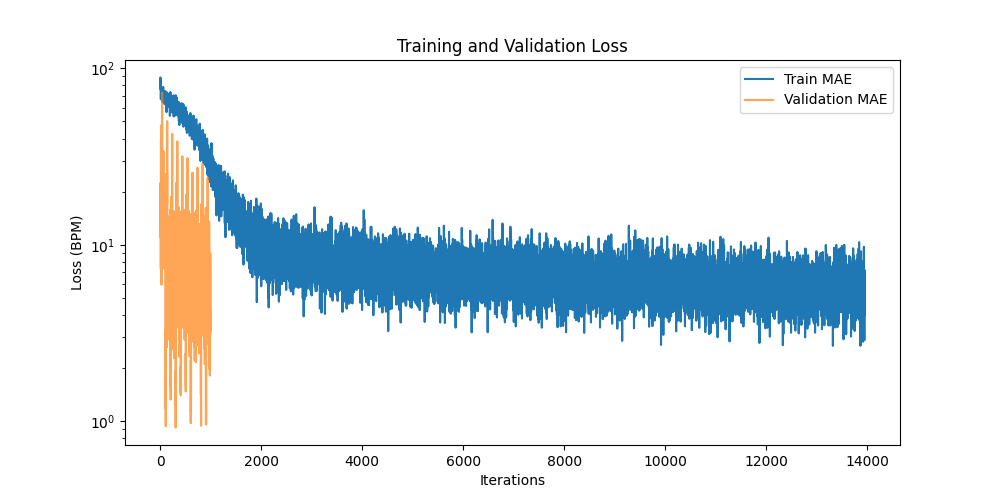
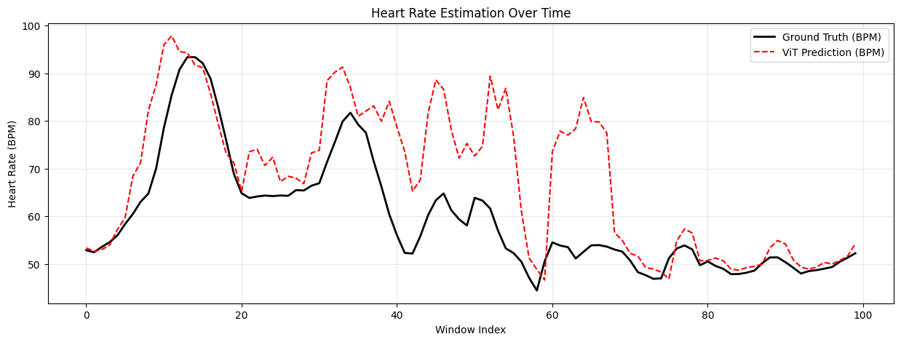

# Heart Rate Regression with Vision Transformer

Estimates heart rate (BPM) from PPG scalogram "images" using a Vision Transformer (ViT), by fine-tuning Google's pretrained `vit-base-patch16-224` on 4-channel input instead of the usual 3-channel RGB.

## How it works

- **Data**: Each sample is a 4-channel scalogram window (time-frequency representation of a PPG signal) paired with a ground-truth heart rate label, stored per-subject as `{subject}_X.npy` / `{subject}_y.npy`. `ScalogramDataset` (`src/data/dataset.py`) memory-maps these arrays so only the needed window is loaded into RAM per sample.
- **Model**: `create_hf_vit_regression` (`src/models/vit.py`) loads `google/vit-base-patch16-224` with its classification head swapped for a single regression output (`num_labels=1`), and its patch-embedding Conv2d expanded from 3 to 4 input channels (the 4th channel's weights are initialized from the pretrained red channel).
- **Loss / metric**: L1 loss (MAE) in BPM, implemented in `src/utils/metrics.py`.
- **Splits**: Subjects are split into train/val/test (configurable via CLI args), e.g. defaults: train `S1,S2,S4,S7-S13`, val `S3,S5`, test `S6,S14,S15`.

## Repo layout

```
train.py              # training loop, checkpointing, final MAE eval + loss plot
evaluate.py            # loads a checkpoint and plots predicted vs. actual HR over time (validation subjects)
src/
  data/dataset.py      # ScalogramDataset
  models/vit.py         # 4-channel ViT regression model
  utils/metrics.py      # MAE loss + evaluation helper
  utils/visualize.py    # prediction time-series plotting
checkpoints/            # loss_plot.png (model .pth files are gitignored, ~1GB each)
processed_NP/           # expected location for {subject}_X.npy / {subject}_y.npy (gitignored, ~25GB)
results/                # predicted vs. actual HR plots (hr_evaluation_plot_e1..e10.png), one per epoch checkpoint
log.txt                 # example training run log
```

Large artifacts (`checkpoints/*.pth`, `processed_NP/*.npy`) are excluded from version control — see `.gitignore`.

## Usage

```bash
pip install -r requirements.txt

# Train
python train.py --data_dir processed_NP --epochs 10 --batch_size 32

# Evaluate a checkpoint and plot predictions
python evaluate.py --data_dir processed_NP --checkpoint checkpoints/vit_ppg_checkpoint_e10.pth --save_path results/hr_evaluation_plot_e10.png
```

## Results (10 epochs, see `log.txt`)

| Split | MAE (BPM) |
|-------|-----------|
| Train | 5.60 |
| Validation | 15.27 |
| Test | 8.17 |





## Notes and limitations

- **Heart rate only.** The model regresses heart rate. It does not estimate blood pressure.
- **Subject-level splits.** Train, validation and test sets contain different subjects, so the numbers measure generalisation to people the model has not seen.
- **Validation is small and noisy.** It uses only two subjects (S3, S5), which is likely why validation MAE (15.27 BPM) differs so much from test MAE (8.17 BPM). Results come from a single 10-epoch run, with no repeated seeds or confidence intervals.
- **Baselines.** No classical baseline (for example peak detection on the raw PPG) is included, so these numbers should not be read as an improvement over standard methods.
- **Data and checkpoints are not included.** The processed arrays (~25 GB) and model weights (~1 GB each) are excluded to keep the repository small. `log.txt` is the output of the run reported above.
